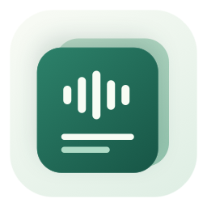

<div align="center">



# LocalVerbatim

**Private, local meeting recording and English/Mandarin transcription for Apple Silicon Macs.**

`Apple Silicon` · `macOS 15+` · `Qwen3-ASR-1.7B (MLX)` · `Apache-2.0`

**[Download v0.5.0 Preview DMG](https://github.com/JALin2000/LocalVerbatim/releases/download/v0.5.0-preview.1/LocalVerbatim-0.5.0-preview-mac-arm64.dmg)** (~117 MB) · [Release Notes & Checksums](https://github.com/JALin2000/LocalVerbatim/releases/tag/v0.5.0-preview.1) · [简体中文](README.zh-CN.md)

</div>

---

LocalVerbatim captures your microphone and computer audio as separate local tracks, transcribes both on-device with MLX, and keeps your original recordings, transcripts, and notes together in one offline workspace.

## Highlights

- **Dual-Track Capture & Audio Import** — Record your microphone (`Me`) and computer playback (`Participants`) into separate WAV files without any meeting bot, or import existing `MP3`, `M4A`, and `WAV` recordings.
- **100% On-Device AI** — Runs [Qwen3-ASR-1.7B](https://huggingface.co/Qwen/Qwen3-ASR-1.7B) natively on Apple Silicon via MLX for English, Mandarin, and mixed-language speech. Choose between [BF16](https://huggingface.co/mlx-community/Qwen3-ASR-1.7B-bf16) (higher accuracy, 4.08 GB) and [8-bit](https://huggingface.co/mlx-community/Qwen3-ASR-1.7B-8bit) (lower memory, 2.47 GB), verified against pinned hashes in [model-manifest.json](engine/model-manifest.json) and [model-manifest-8bit.json](engine/model-manifest-8bit.json).
- **Live Draft + Second Pass** — Generates incremental transcripts while you record, then optionally runs a full-context second pass after stopping. Original transcripts are always preserved, and you can stop, resume, rerun with updated terminology, or compare earlier passes.
- **Terminology & Clean Reading** — Save reusable terminology templates, inherit terms from your last recorded meeting, and toggle conservative filler reduction (plus Chinese repetition cleanup in second-pass text) without altering saved model output.
- **Complete Local Workspace** — Side-by-side notes, click-to-play timestamps, `TXT` / `Markdown` / `SRT` export, recoverable Trash deletion, Chinese/English UI, light/dark mode, and optional Dock hiding for shortcut-started recordings.

## Quick Start

1. **Install** — Download the [v0.5.0 Preview DMG](https://github.com/JALin2000/LocalVerbatim/releases/download/v0.5.0-preview.1/LocalVerbatim-0.5.0-preview-mac-arm64.dmg) (includes Python and MLX runtime; no Homebrew or Xcode needed) and drag **LocalVerbatim** to **Applications**.

   > [!NOTE]
   > The v0.5.0 preview DMG is ad-hoc signed and not notarized by Apple. On first launch, macOS may require **System Settings → Privacy & Security → Open Anyway** (managed Macs may restrict unnotarized apps). See the [installation guide](docs/INSTALL.md) for details.

2. **Set up model & permissions** — Launch the app, pick English or 简体中文, download or import your preferred model (`8-bit` recommended for ≤ 8 GB RAM; `BF16` for > 8 GB RAM), and grant **Microphone** and **Screen & System Audio Recording** permissions.
3. **Verify & record** — Run **Settings → Recording → Run 10-second audio test** to confirm both sources receive audio, then start recording from the window, menu bar, or global shortcuts.

## Global Shortcuts

| Action | Default Shortcut |
|---|---|
| Start recording | `⌃⌥R` (`Control + Option + R`) |
| Stop recording | `⌃⌥S` (`Control + Option + S`) |
| Show main window | `⌃⌥L` (`Control + Option + L`) |

All shortcuts can be customized in **Settings → Shortcuts**, where you can also enable **Hide the Dock icon for shortcut-started recordings** (the menu-bar icon remains visible).

## Requirements

| Item | Requirement |
|---|---|
| **Mac & OS** | Apple Silicon Mac, macOS 15 or later |
| **Memory** | 16 GB recommended (`8-bit`: 2.47 GB, `BF16`: 4.08 GB; auto-stops transcription at 90% RAM while keeping audio) |
| **Storage** | 6 GB+ for app and model, plus ~230 MB/hour for dual-track 16 kHz mono PCM16 recordings |
| **Network** | Needed only for initial model download; recording and transcription work offline |

## How Meetings Are Stored

Each meeting is stored in a self-contained folder under `date · title [ID]/`:

```text
YYYY-MM-DD HH-MM · Meeting Title [ID]/
├── microphone.wav          # Full microphone track
├── system.wav              # Full computer audio track
├── Transcripts/            # Auto-exported TXT, Markdown, and SRT
└── .localverbatim/         # Metadata, notes, chunks, and pass history
```

Upgrading from **LocalScribe** automatically preserves your existing recordings, models, settings, and terminology templates.

## Good to Know

- **Source labels, not speaker diarization**: `Me` and `Participants` identify the audio track (`microphone` vs. `system`), rather than separating multiple remote speakers by voice.
- **Use headphones**: There is no acoustic echo cancellation yet; headphones prevent speaker audio from re-entering the microphone track.
- **Review key details**: Severe decoder repetition loops trigger bounded local retries, though rare names, numbers, and language switches should still be verified against playback.
- **Local-first scope**: Cloud sync, automatic AI summaries, calendar integration, and an auto-updater are intentionally not included.

## Build from Source & Docs

```sh
git clone https://github.com/JALin2000/LocalVerbatim.git && cd LocalVerbatim
bash setup.command
open LocalVerbatim.app
```

| Guide | Link |
|---|---|
| Install, permissions, upgrade & uninstall | [docs/INSTALL.md](docs/INSTALL.md) · [中文版](docs/INSTALL.zh-CN.md) |
| Build, test & DMG packaging | [docs/DEVELOPMENT.md](docs/DEVELOPMENT.md) · [中文版](docs/DEVELOPMENT.zh-CN.md) |
| Local data & network behavior | [docs/PRIVACY.md](docs/PRIVACY.md) |
| Release history | [CHANGELOG.md](CHANGELOG.md) |

## License & Contributing

Original code, documentation, and icon artwork are licensed under [Apache-2.0](LICENSE) (see [NOTICE](NOTICE)). Bundled third-party packages and Qwen3-ASR weights retain their own licenses in [THIRD_PARTY_NOTICES.md](THIRD_PARTY_NOTICES.md). Contributions are welcome—see [CONTRIBUTING.md](CONTRIBUTING.md) and [SECURITY.md](SECURITY.md) (please keep real meeting recordings and transcripts out of public issues).
