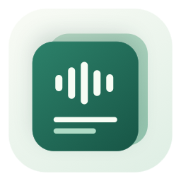

# 本地逐字稿 · LocalVerbatim

[English](README.md)

面向 Apple Silicon Mac 的本地会议录音与中英文转写应用。

分别录下麦克风和电脑声音，在本机转成逐字稿，保留完整录音，并在同一页面阅读逐字稿、记录笔记。

**[下载 Mac 预览版 DMG](https://github.com/JALin2000/LocalVerbatim/releases/download/v0.5.0-preview.1/LocalVerbatim-0.5.0-preview-mac-arm64.dmg)** · Apple Silicon · macOS 15+ · 约 117 MB。[发行说明与校验和](https://github.com/JALin2000/LocalVerbatim/releases/tag/v0.5.0-preview.1)。

**当前状态：** **LocalVerbatim／本地逐字稿** v0.5.0 预览版。安装包采用**临时签名，未经过 Apple 公证**。首次尝试打开后，可能需要到“系统设置 → 隐私与安全性 → 仍要打开”手动允许；受管理的 Mac 可能禁止此例外，详见[安装说明](docs/INSTALL.zh-CN.md)。全新 Mac 首装及更广泛的系统／硬件验证仍待完成。

从 LocalScribe 升级会继续使用现有会议库、模型、设置和术语模板，历史数据目录与应用标识保持稳定。无需搬动或重命名录音，详见[升级说明](docs/INSTALL.zh-CN.md#升级备份与卸载)。

## 功能

- 同时采集麦克风与系统音频，分别保存 WAV 音轨并标注来源。
- 导入 MP3、M4A 或 WAV 录音，支持本地转写、回放和自动二次识别。
- 使用 Qwen3-ASR-1.7B 与 MLX 本地识别，提供 BF16 和 8 位量化两版，面向英语、普通话及混合会议。
- 录音期间分段更新逐字稿，停止后可自动进行二次识别。
- 保留原始逐字稿；二次识别可停止、继续，也可更新术语后重新运行。此前的二次稿可切换查看和导出。
- 常用术语模板；新会议沿用上一场实际录音的术语与背景。
- 一键切换原文与减少语气词的显示结果；二次稿还会合并明显的中文口头重复，模型原文保留。
- 会议笔记、时间戳回放、TXT/Markdown/SRT 导出，以及可从废纸篓恢复的会议删除。
- 中英文界面、浅色与深色模式、全局快捷键、存储位置设置和双路收音自检。
- 快捷键启动录音时可选择隐藏 Dock 图标，菜单栏入口始终保留。

## 运行要求

| 项目 | 当前支持范围 |
|---|---|
| 电脑 | Apple Silicon Mac；暂不支持 Intel Mac 和 Windows |
| 系统 | macOS 15 或更新；最低系统版本还需更广泛的实机验证 |
| 内存 | 建议 16 GB；尚未验证 8 GB 配置 |
| 模型下载 | 8 GB RAM 及以下推荐 8 位版（约 2.47 GB），超过 8 GB 推荐 BF16（约 4.08 GB） |
| 磁盘 | 为应用和模型预留至少 6 GB，另留录音和下载工作空间 |
| 网络 | 下载模型时需要；模型就绪后可离线录音与识别 |
| 权限 | 麦克风、屏幕与系统音频录制 |

录音为 16 kHz、单声道、PCM16。两条完整音轨合计每小时约 230 MB，**另有**识别片段和导出文件，磁盘占用随会议时长增长。

每场会议使用“日期 · 会议名 [ID]”文件夹：顶层保留两条完整 WAV，导出逐字稿放在 `Transcripts/`，中间片段和识别记录放在隐藏的 `.localverbatim/`。备份时请保留**整个文件夹及隐藏文件**。升级时会自动整理旧目录，详见[安装说明](docs/INSTALL.zh-CN.md)。

## 开始使用

下载 [Mac 预览版](https://github.com/JALin2000/LocalVerbatim/releases/download/v0.5.0-preview.1/LocalVerbatim-0.5.0-preview-mac-arm64.dmg)并按[安装说明](docs/INSTALL.zh-CN.md)操作。包内包含 Python 和识别依赖。首次启动时可选择界面语言，再下载或导入所选模型。另一版本也可在**设置 → 转写**下载。从源码构建请阅读[开发说明](docs/DEVELOPMENT.zh-CN.md)。

使用独立安装包不需要安装 Python、Homebrew 或 Xcode。模型就绪后，运行**设置 → 录音 → 10 秒收音测试**；重要会议前，确认两路均收到音频。

| 文档 | 简体中文 | English |
|---|---|---|
| 安装、权限、故障排查、升级与卸载 | [安装说明](docs/INSTALL.zh-CN.md) | [Installation](docs/INSTALL.md) |
| 构建、测试和打包 | [开发说明](docs/DEVELOPMENT.zh-CN.md) | [Development](docs/DEVELOPMENT.md) |
| 本地数据与联网行为 | [隐私说明](docs/PRIVACY.md) | [同一文档](docs/PRIVACY.md) |

默认全局快捷键：**Control + Option + R** 开始录音，**Control + Option + S** 停止录音，**Control + Option + L** 显示主窗口，均可在设置中修改。

## 模型与实际边界

应用使用 [Qwen3-ASR-1.7B](https://huggingface.co/Qwen/Qwen3-ASR-1.7B) 的 [MLX BF16](https://huggingface.co/mlx-community/Qwen3-ASR-1.7B-bf16) 或 [MLX 8 位](https://huggingface.co/mlx-community/Qwen3-ASR-1.7B-8bit)权重。[BF16](engine/model-manifest.json) 和 [8 位](engine/model-manifest-8bit.json)模型清单固定了版本与文件哈希。同一份模型串行处理两个来源；长录音分窗口读取。

在 M4、16 GB 内存的短时本地测试中，BF16 的**识别进程物理内存**约为 5.2–5.4 GB。同一台 Mac 上，8 位版处理短英文、普通话及二次识别的测试峰值约为 **3.35 GB**。这不是整个系统的内存占用，也不保证其他设备得到相同结果。识别进程达到本机 RAM 的 90% 时，应用会停止转写并保留录音。8 GB 机器的阈值为 7.2 GB，系统和其他应用也占用这 8 GB 内存。可先用「预载并测试内存」做初步检查。

- 检测到严重循环重复时，会从原音频进行有限次数的本地重试，并保存异常原始输出；仍未通过则报告失败，不采用循环文字。这不能发现所有识别错误。
- 人名、数字、专业词及语言切换仍可能识别错误，重要内容应对照录音校对。二次识别不保证每句话都更准确。
- “我／与会者”表示音频来源，尚不能通过声纹区分多位远端与会者。
- 时间戳是片段级而非逐字对齐；尚无声学回声消除，建议使用耳机以减少外放重复收音。
- 尚未实现自动摘要、云端同步或日历集成。
- 没有自动更新功能；正式签名发行和 Windows 支持属于后续工作。

## 许可证

本项目的原创代码、文档和原创图标采用 [Apache-2.0](LICENSE)，署名见 [NOTICE](NOTICE)。第三方依赖和模型保留各自许可，详见 [THIRD_PARTY_NOTICES.md](THIRD_PARTY_NOTICES.md)。此源码目录不包含模型权重或 Python 运行时。

版本变化见[更新记录](CHANGELOG.md)，公开发行准备情况见[发布清单](docs/RELEASE_CHECKLIST.md)。

报告问题或提交修改前，请阅读[参与贡献 / Contributing](CONTRIBUTING.md)。疑似漏洞请遵循[安全说明 / Security](SECURITY.md)；不要在公开 issue 中提交会议录音、逐字稿或个人数据。
